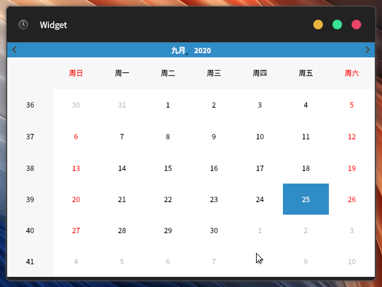
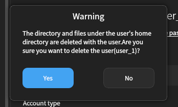
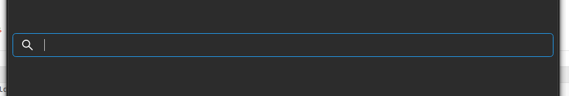
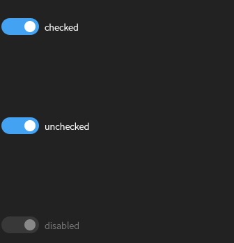
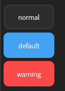
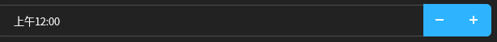
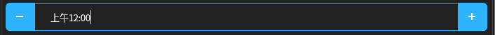
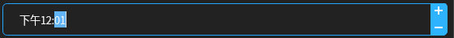
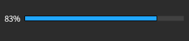
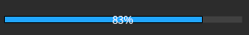

# kiranwidgets-qt5

A set of custom Qt5 widgets and component wrappers tailored for the Kiran Desktop Environment.

## Build

1. Install build dependencies.

    ```bash 
    sudo yum install cmake gcc-c++ qt5-qtbase-devel qt5-linguist qt5-qtsvg-devel qt5-qtx11extras-devel libX11-devel xcb-util-devel gsettings-qt-devel
    ```

2. Create and navigate to the `build` directory at the root of the source tree.

   ```bash
   mkdir build
   ```

3. Generate Makefiles via CMake.

   ```bash
   cmake -DCMAKE_INSTALL_PREFIX=/usr ..
   ```

4. Run `make` to compile the project.

## Installation

Run `sudo make install` in the `build` directory.

## Uninstallation

Run `sudo make uninstall` in the `build` directory.

## Usage

Install `examples` and navigate to `/usr/share/kiranwidgets-qt5/examples/`.

## Component Reference

### KiranApplication

A custom subclass wrapper of `QApplication` designed specifically for the Kiran Desktop Environment.

Current features:

- **Font monitoring:** Automatically monitors MATE desktop font settings, tracks changes to the application font via `org.mate.interface font-name`, and monitors the window title bar font via `org.mate.Marco.general titlebar-font`.
- **Default theme engine:** Automatically initializes and forces `KiranStyle` as the default application style.

Upcoming features:

- **Theme awareness:** Implements dynamic system theme tracking to automatically reload and refresh `KiranStyle` upon system theme changes.
- **Display scaling:** Implements dynamic display scaling factor detection to natively adapt and scale the Qt application layout on the fly.

#### Header Location

`/usr/include/kiranwidgets-qt5/kiran-applicaiton.h`

#### Examples

None.

### KiranSingleApplication

Integrated third-party single-instance application code and refactored its base class to `KiranApplication`.

#### Header Location

`/usr/include/kiranwidgets-qt5/kiran-single-application.h`

#### Examples

None.

### kiran-titlebar-window



Custom title bar window.

#### Header Location

`/usr/include/kiranwidgets-qt5/kiran-titlebar-window.h`

#### Examples

##### KiranTitlebarWindow_UI

Example code for demonstrating how to design and generate a user interface.

###### Notes

Because the parameter passed to `setupUi` is the `QWidget` created by `KiranTitlebarWindow` (the area specifically used to display window content) instead of `this`:

- Do not add signals and slots via the QtDesigner's **Signals and Slots Editor**.
  
  Connections made in the QtDesigner's **Signals and Slots Editor** will, in the generated `setupUi` method, connect the UI controls to the slots of the `QWidget` created by `KiranTitlebarWindow`. This fails because the parameter passed to `setupUi` is of the child control `QWidget` type created by `KiranTitlebarWindow`.
- Try not to add slot functions by right-clicking a control in QtDesigner.
  
  This action actually generates a slot function with a standardized function name, which is connected via `QMetaObject::connectSlotsByName(...)` inside `setupUi`. Because the parameter passed to `setupUi` is of the child control `QWidget` type created by `KiranTitlebarWindow`, the connection cannot be established.

##### KiranTitlebarWindow_CPP

Example code for generating the interface via code.

##### KiranTitlebarWindow_Simple

Using a purely procedural approach without deriving from `KiranTitlebarWindow`.

### KiranMessageBox



Custom message dialog box.

#### Header Location

`/usr/include/kiranwidgets-qt5/kiran-message-box.h`

#### Examples

##### static_method

Use static methods to quickly utilize `KiranMessageBox`.

##### instantiation

Instantiate and customize buttons to utilize `KiranMessageBox`.

### KiranSearchBox



Derived from `QLineEdit`, with its rendering modified in `KiranStyle`.

#### Header Location

`/usr/include/kiranwidgets-qt5/kiran-search-box.h`

#### Examples

None.

### KiranSwitchButton



Derived from `QAbstractButton`, with `SwitchButton` rendering support added to `KiranStyle`.

#### Header Location

`/usr/include/kiranwidgets-qt5/kiran-switch-button.h`

#### Examples

None.

## KiranStyle

In the `KiranApplication` constructor, the default style is set to `KiranStyle` to unify the style and adapt to system theme updates.

Certain widget rendering details can be managed via `**/usr/include/kiranwidgets-qt5/style-property-helper.h**` to control the rendering behavior of `KiranStyle`.

------

### QPushButton



`KiranStyle` has three built-in rendering styles for buttons (`Normal`, `Default`, `Warning`), which can be retrieved and set via the `getButtonType`/`setButtonType` methods in `style-property-helper.h`.

- **BUTTON_Normal**: default value, indicating buttons will be rendered as `Normal` by default.
- **BUTTON_Default**
- **BUTTON_Warning**

------

### QSpinBox Types (QSpinBox, QTimeEdit, QDateEdit, QDateTimeEdit)

`KiranStyle` provides four options for the button rendering positions of SpinBox-like controls (`QSpinBox`, `QTimeEdit`, `QDateEdit`, `QDateTimeEdit`):

- `ARROW_HORIZONTAL_STACK`: Horizontal stack



- `ARROW_TWO_SIDERS`: Two sides (left and right)

  

- `ARROW_VERTICAL_STACK`: Vertical stack

  

- `ARROW_POSITION_AUTOMATIC`: Automatic layout

  Automatically lays out the buttons based on the width of the SpinBox:
  - When the width is too small, `ARROW_VERTICAL_STACK` layout is used.
  - When the width is too large, `ARROW_HORIZONTAL_STACK` layout is used.
  - When the width is moderate, `ARROW_TWO_SIDERS` layout is used.

  ------

### QProgressBar

`KiranStyle` provides three text rendering options for `QProgressBar`:

- `PROGRESS_TEXT_LEFT`: Progress text is displayed on the left.



- `PROGRESS_TEXT_CENTER`: Progress text is displayed in the center.



- `PROGRESS_TEXT_RIGHT`: Progress text is displayed on the right.


